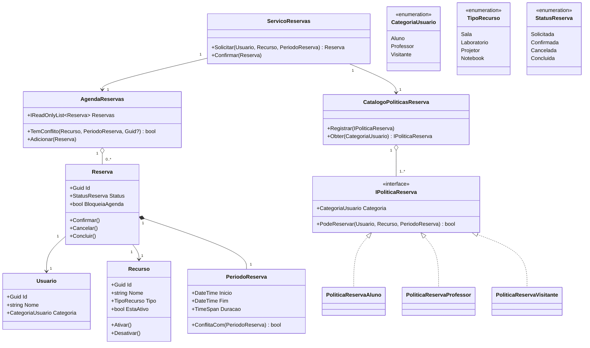

# Modelo final

O diagrama abaixo representa as classes centrais da solução concluída, seus relacionamentos e multiplicidades, a composição entre Reserva e PeriodoReserva e o contrato das políticas de reserva.

## Leitura do modelo

Uma Reserva associa exatamente um Usuario e um Recurso e possui exatamente um PeriodoReserva. A ligação com o período é uma composição, representada pelo losango preenchido, porque o período é parte obrigatória da reserva, nasce junto com ela no construtor e não pode ser substituído externamente.

A AgendaReservas agrega várias reservas, mas expõe essa coleção apenas como leitura, por meio de uma IReadOnlyList, de modo que nenhuma reserva possa ser inserida ou removida sem passar pelo método Adicionar, onde as regras de conflito e de recurso ativo são verificadas.

O ServicoReservas colabora com a agenda e com o catálogo de políticas. Em vez de decidir por conta própria o que cada categoria pode fazer, ele obtém do CatalogoPoliticasReserva a política correspondente ao usuário e executa essa política. O contrato comum é a interface IPoliticaReserva, implementada por PoliticaReservaAluno, PoliticaReservaProfessor e PoliticaReservaVisitante. Essa organização permite acrescentar novas políticas sem alterar o serviço.
